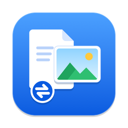

<div align="center">



# QuickConvert

**Convert, compress and crop files right from Finder.**<br>
Select files, press <kbd>⌃</kbd> <kbd>⇧</kbd> <kbd>Space</kbd>, and pick what you need from a small popup at your cursor.

[](https://github.com/Ripun-Build/quickconvert/releases/latest)
[](#install)
[](#install)
[](LICENSE)

### [⬇&nbsp; Download for Mac](https://github.com/Ripun-Build/quickconvert/releases/latest)


</div>

<br>

**Private by design.** Everything runs on your Mac and your files are never uploaded. QuickConvert only goes online if you ask it to install LibreOffice.<br>
**Your originals are safe.** Every action writes a new file next to the original, or into a folder you choose. Nothing is changed or overwritten.

## What it does

### 🖼️ Photos

JPG, PNG, WebP, HEIC, TIFF, BMP and GIF.

<table>
<tr>
<td width="50%" valign="top">

- **Combine into PDF:** drag pages into order, turn them, leave some out and preview the result. JPEGs go in without losing quality.
- **Convert:** JPG, PNG or WebP, keeping each photo's colours.
- **Resize:** drag the corner or type a size. It never enlarges by accident.
- **Compress:** hit a limit like *under 50 KB* for exam and job portals, with the real size shown before you start.
- **Crop:** free, square, 4:3, 3:4, 16:9 or passport 35 × 45 mm.
- **Rotate:** QuickConvert uses each photo's text and faces to work out which way up it should be.
- **Remove location & camera info:** takes out GPS, camera details, dates and other hidden info.
- **Presets:** one-click recipes like *Exam photo 200 × 230 px, 20–50 KB*. Edit them or make your own.

</td>
<td width="50%" valign="top">


</td>
</tr>
</table>

iPhone **HEIC** photos work with every action. Results that keep the format are saved as JPG at about the original's size; *Remove location & camera info* keeps them HEIC. Built-in preset values are examples, so always check the official notice.

### 📄 PDFs

<table>
<tr>
<td width="50%" valign="top">


</td>
<td width="50%" valign="top">

- **PDF to JPG / PNG:** pick pages on thumbnails or type a range like `1-3, 5`. Sizes are named for their use: Screen, Standard, Print.
- **Merge PDFs:** two or more PDFs become one, in the order you selected them.
- **Split PDF:** click where new parts start, split every 1, 2 or 3 pages, or keep just the pages you pick.
- **Rotate pages:** sideways pages are found and turned. Nothing is re-saved, so quality stays the same.
- **Make PDF smaller:** Smallest, Balanced or Print, with the real new size shown first. Text stays sharp.

</td>
</tr>
</table>

### 📊 Word, PowerPoint and Excel to PDF

<p align="center">
  
</p>

Choose how each kind of file becomes a PDF:

| | Quick (built in) | Exact copy |
|---|---|---|
| **Made with** | macOS itself | Pages, Keynote, Numbers or LibreOffice |
| **Setup** | Nothing to install | Install the free app once; QuickConvert uses it automatically |
| **Result** | Close to the original, not 100% the same | Keeps the layout, fonts, pictures and tables |
| **Works for** | Word and Excel | Word, PowerPoint and Excel |

- **Install from inside the app.** Pages, Keynote and Numbers open their free App Store page. LibreOffice is downloaded from libreoffice.org, checked to be the genuine file and installed for you, after asking first.
- **No font downloads.** Fonts your Mac doesn't have are swapped for the closest ones it does (Univers → Helvetica Neue, for example) in a temporary copy, and the result tells you which were swapped.
- **Details when you want them.** The ⓘ next to each choice says what it is, why it's better, which version you have and how big it is.

<details>
<summary><b>Supported file types</b></summary>

<br>

| Kind | Files |
|---|---|
| Word | `.docx` `.doc` `.rtf` `.odt` `.pages` |
| PowerPoint | `.pptx` `.ppt` `.key` `.odp` |
| Excel | `.xlsx` `.xls` `.xlsm` `.xlsb` `.ods` `.csv` `.numbers` |

PowerPoint files, along with `.key`, `.pages` and `.numbers`, need Keynote, Pages, Numbers or LibreOffice.

</details>

## More screenshots

<table>
<tr>
<td width="50%"></td>
<td width="50%"></td>
</tr>
<tr>
<td></td>
<td></td>
</tr>
<tr>
<td></td>
<td></td>
</tr>
<tr>
<td colspan="2" align="center"></td>
</tr>
</table>

## Install

1. **Download** `QuickConvert_<version>_universal.dmg` from [Releases](https://github.com/Ripun-Build/quickconvert/releases/latest) and drag **QuickConvert** to **Applications**. Already have an older version? See [Updating](#updating).
2. **Open it the first time:** right-click (or Control-click) **QuickConvert** in Applications and choose **Open**, then **Open** again. You only need to do this once.
3. **Find it in the menu bar.** There's no Dock icon. The first time you use it on a Finder selection, macOS asks whether QuickConvert may control Finder. Choose **Allow** so it can see which files you've selected.

> [!NOTE]
> The app isn't notarised by Apple yet, so macOS says it's from an unidentified developer. On recent macOS versions, if there's no Open button, try to open it once, then go to **System Settings → Privacy & Security** and click **Open Anyway**.

### Updating

QuickConvert doesn't check for updates by itself yet. To get a new version:

1. **Quit QuickConvert first:** menu bar icon → **Quit**. If the old version keeps running, both fight over the shortcut.
2. Download the new `.dmg` from [Releases](https://github.com/Ripun-Build/quickconvert/releases/latest), drag **QuickConvert** to **Applications** and choose **Replace**.
3. **Right-click → Open → Open once more.** macOS treats each new version as a new app, so the warning comes back one time.
4. If macOS asks again whether QuickConvert may control Finder, choose **Allow**.

Your settings, presets and *Launch at login* carry over. To hear about new versions, click **Watch → Custom → Releases** on this page.

## How to use it

Select files in Finder and press <kbd>⌃</kbd> <kbd>⇧</kbd> <kbd>Space</kbd>. The popup appears at the pointer with the best actions first, under *Suggested*.

| Keys | What they do |
|---|---|
| Type | Search actions |
| <kbd>↑</kbd> <kbd>↓</kbd> and <kbd>Return</kbd> | Choose an action |
| <kbd>1</kbd>–<kbd>9</kbd> | Jump straight to an action |
| <kbd>Esc</kbd> | Go back one step |
| <kbd>⌘</kbd> <kbd>W</kbd> or **×** | Close the popup |
| <kbd>⌘</kbd> <kbd>,</kbd> | Open Settings |

- The popup stays open until you close it, so you can drag in more files or switch apps. Drag its top bar to move it.
- No selection? The popup opens as a drop zone: drag files in or click **Choose files…**.
- **Settings** (menu bar icon → Settings…, or the ⚙ in the popup): change the shortcut, appearance (System / Light / Dark), where files are saved, default quality and sizes, presets, how Word, PowerPoint and Excel files are made into PDFs, and launch at login.

## For developers

<details>
<summary><b>Build from source</b></summary>

<br>

Requirements: [Rust](https://rustup.rs) (stable), Node.js LTS, and Xcode Command Line Tools (`xcode-select --install`).

```bash
npm install
sh scripts/fetch-pdfium.sh   # once: downloads the PDF engine (pinned version, checksum-verified)
npm run tauri dev            # run in development
```

Release build (universal: Apple Silicon + Intel):

```bash
rustup target add aarch64-apple-darwin x86_64-apple-darwin
npm run tauri build -- --target universal-apple-darwin
```

The `.dmg` ends up in `src-tauri/target/universal-apple-darwin/release/bundle/dmg/`.

Checks:

```bash
cd src-tauri && cargo test && cargo clippy --all-targets -- -D warnings
npm test && npx tsc --noEmit
```

</details>

Docs: [SPECS](docs/SPECS.md) (what it does) · [DESIGN](docs/DESIGN.md) (design system) · [TASKS](docs/TASKS.md) (milestones)

## Licences

QuickConvert is released under the [MIT License](LICENSE).

It bundles open-source components, all under permissive licences (MIT, Apache-2.0, BSD and similar; nothing GPL), including the [PDFium](https://pdfium.googlesource.com/pdfium/) engine built by [bblanchon/pdfium-binaries](https://github.com/bblanchon/pdfium-binaries). The full list, with every Rust crate and JavaScript package, is in [THIRD_PARTY_LICENSES.md](THIRD_PARTY_LICENSES.md); licence texts for PDFium and its parts are in [`src-tauri/resources/pdfium/licenses`](src-tauri/resources/pdfium/licenses) and ship inside the app.
