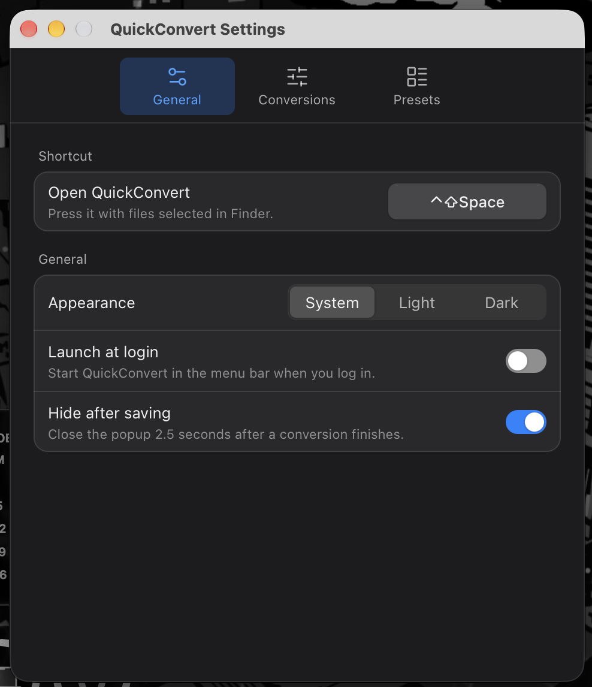

# QuickConvert

Select files in Finder → press **⌃⇧Space** → convert, compress or resize them from a small popup at your cursor.
Offline and private: your files never leave your Mac.


## What it does

| Action | Details |
|---|---|
| **Combine into PDF** | Photos and scans → one PDF. Phone photos stay upright; JPEGs are embedded without losing quality. Page size: fit to image, A4 or Letter. |
| **PDF to JPG / PNG** | Pick pages on thumbnails or type a range like `1-3, 5`. Sizes named for what they're for: Screen, Standard, Print. |
| **Merge PDFs** | Two or more PDFs → one, in the order you selected them. |
| **Convert to…** | JPG, PNG or WebP, keeping each photo's colours. |
| **Resize** | Drag the image's corner or type the width and height; both stay in sync. Never enlarges by accident. |
| **Compress** | To a size limit (e.g. *under 50 KB* for exam and job portals) or by quality, with the real resulting size shown before you start. |
| **Presets** | One-click recipes like *Exam photo 200 × 230 px, 20–50 KB* or *Passport 35 × 45 mm*. Edit them or make your own in Settings. Built-in values are examples: always check the official notice. |

Every action writes a new file next to the original (or into a folder you choose) and never changes or overwrites the original.

| | |
|---|---|
|  |  |
|  |  |

## Install (macOS 12 or later, Apple Silicon or Intel)

1. Download `QuickConvert_<version>_universal.dmg` from the [Releases](https://github.com/Ripun-Build/quickconvert/releases) page and drag **QuickConvert** to **Applications**.
2. **First launch:** the app isn't notarised by Apple yet, so macOS will say it's from an unidentified developer. Right-click (or Control-click) **QuickConvert** in Applications and choose **Open**, then **Open** again. You only need to do this once.
   On recent macOS versions, if there's no Open button: try to open it once, then go to **System Settings → Privacy & Security** and click **Open Anyway**.
3. QuickConvert lives in the **menu bar** (no Dock icon). The first time you use it on a Finder selection, macOS asks whether QuickConvert may control Finder: choose **Allow** so it can see which files you've selected.

## Use

- **Select files in Finder, press ⌃⇧Space.** The popup appears at the pointer with the actions that make sense for those files, the best ones first under *Suggested*.
- Type to search, use **↑ ↓** and **Return**, or press **1–9**. **Esc** goes back or closes.
- No selection? The popup opens as a drop zone: drag files in or click **Choose files…**.
- **Settings** (menu bar icon → Settings…, the ⚙ in the popup, or **⌘,**): change the shortcut, appearance (System / Light / Dark), where files are saved, default quality and sizes, presets, and launch at login.

## Build from source

Requirements: [Rust](https://rustup.rs) (stable), Node.js LTS, and Xcode Command Line Tools (`xcode-select --install`).

```bash
npm install
sh scripts/fetch-pdfium.sh   # once: downloads the PDF engine (pinned version, checksum-verified)
npm run tauri dev            # run in development
```

Release build (universal: Apple Silicon + Intel):

```bash
rustup target add aarch64-apple-darwin x86_64-apple-darwin
npm run tauri build -- --target universal-apple-darwin
```

The `.dmg` ends up in `src-tauri/target/universal-apple-darwin/release/bundle/dmg/`.

Checks:

```bash
cd src-tauri && cargo test && cargo clippy --all-targets -- -D warnings
npm test && npx tsc --noEmit
```

Docs: [SPECS](docs/SPECS.md) (what it does) · [DESIGN](docs/DESIGN.md) (design system) · [TASKS](docs/TASKS.md) (milestones).

## Licences

QuickConvert bundles open-source components, all under permissive licences (MIT, Apache-2.0, BSD and similar; nothing GPL), including the [PDFium](https://pdfium.googlesource.com/pdfium/) engine built by [bblanchon/pdfium-binaries](https://github.com/bblanchon/pdfium-binaries). The full list, with every Rust crate and JavaScript package, is in [THIRD_PARTY_LICENSES.md](THIRD_PARTY_LICENSES.md); licence texts for PDFium and its parts are in [`src-tauri/resources/pdfium/licenses`](src-tauri/resources/pdfium/licenses) and ship inside the app.
