# QuickConvert

Select files in Finder → press **⌃⇧Space** → convert, compress, crop or tidy them from a small popup at your cursor. Works with photos (including iPhone HEIC), PDFs, and Word, PowerPoint and Excel files.
Offline and private: your files never leave your Mac. QuickConvert only goes online if you ask it to install LibreOffice.

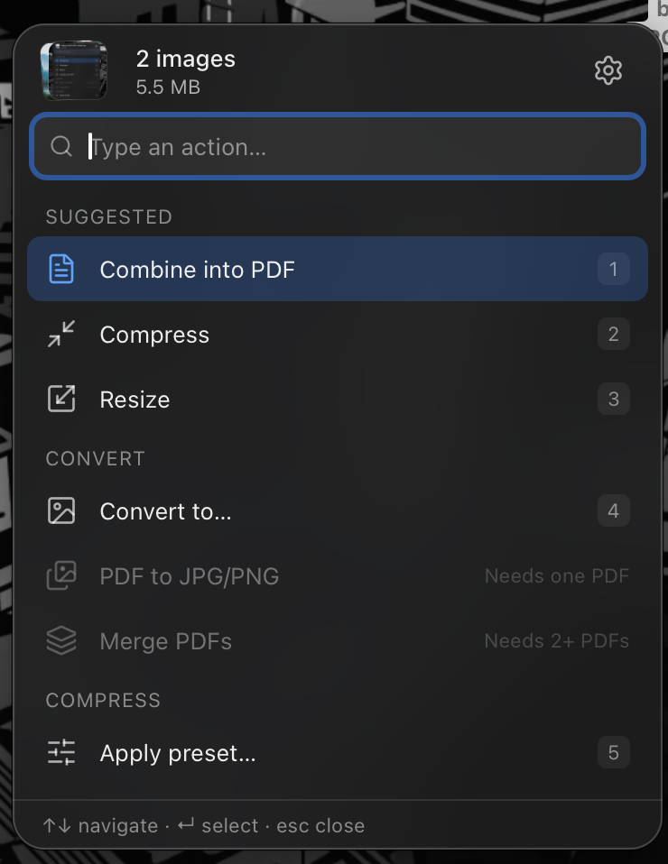

## What it does

**Photos** (JPG, PNG, WebP, HEIC, TIFF, BMP, GIF)

| Action | Details |
|---|---|
| **Combine into PDF** | Photos and scans → one PDF. Arrange the pages first: drag them into order, turn them, leave some out, or let **Straighten photos** fix sideways ones. Each page is previewed for fit to image, A4 or Letter, with or without a margin. JPEGs go in without losing quality. |
| **Convert to…** | JPG, PNG or WebP, keeping each photo's colours. |
| **Resize** | Drag the image's corner or type the width and height; both stay in sync. Never enlarges by accident. |
| **Compress** | To a size limit (e.g. *under 50 KB* for exam and job portals) or by quality, with the real resulting size shown before you start. |
| **Crop** | Drag a box over the photo. Shapes: free, square, 4:3, 3:4, 16:9 and passport 35 × 45 mm (it tells you if the crop is big enough to print). Turn the photo while you crop. |
| **Rotate** | Choose how every photo should end up: straight, left, right or upside down. QuickConvert works out which way each photo is turned now (from its text and faces) and turns each one by what it needs. Click a photo to turn it yourself. |
| **Remove location & camera info** | Takes out GPS location, camera details, dates and other hidden info. JPG, PNG and WebP pictures stay exactly the same; sideways photos stay upright. |
| **Presets** | One-click recipes like *Exam photo 200 × 230 px, 20–50 KB* or *Passport 35 × 45 mm*. Edit them or make your own in Settings. Built-in values are examples: always check the official notice. |

iPhone **HEIC** photos work with every action. Results that keep the format are saved as JPG at about the original's size; *Remove location & camera info* keeps them HEIC.

**PDFs**

| Action | Details |
|---|---|
| **PDF to JPG / PNG** | Pick pages on thumbnails or type a range like `1-3, 5`. Sizes named for what they're for: Screen, Standard, Print. |
| **Merge PDFs** | Two or more PDFs → one, in the order you selected them. |
| **Split PDF** | Click the pages where new parts start (or split every page, every 2, every 3), or keep just the pages you pick as a new PDF. |
| **Rotate pages** | Like *Rotate* for photos: sideways pages are found and turned, or click pages to turn them. Nothing is re-saved, so quality stays the same. |
| **Make PDF smaller** | Smallest, Balanced or Print, with the real new size shown before you start. Scanned pages and photos are made smaller; text stays sharp. |

**Word, PowerPoint and Excel** (`.docx .doc .rtf .odt .pages`, `.pptx .ppt .key .odp`, `.xlsx .xls .xlsm .xlsb .ods .csv .numbers`)

| Action | Details |
|---|---|
| **Word to PDF · PowerPoint to PDF · Excel to PDF** | Choose how each kind of file becomes a PDF. **Quick (built in)** works for Word and Excel straight away, with nothing to install, but isn't 100% the same as the original. For an **exact copy**, QuickConvert uses Pages, Keynote, Numbers or LibreOffice when one is installed, automatically. The **ⓘ** next to each choice says what it is, why it's better, which version you have and how big it is. |
| **Install** | No app for a file type yet? **Install** opens the App Store page for Pages, Keynote or Numbers (free, from Apple), or downloads LibreOffice (free) from libreoffice.org, checks it's the genuine file and installs it into Applications for you, after asking first. |

PowerPoint files (and `.key`, `.pages`, `.numbers`) need Keynote, Pages, Numbers or LibreOffice. Fonts the file uses that your Mac doesn't have are swapped for the closest ones it does (for example Univers → Helvetica Neue) in a temporary copy, so nothing needs downloading; the result tells you which fonts were swapped.

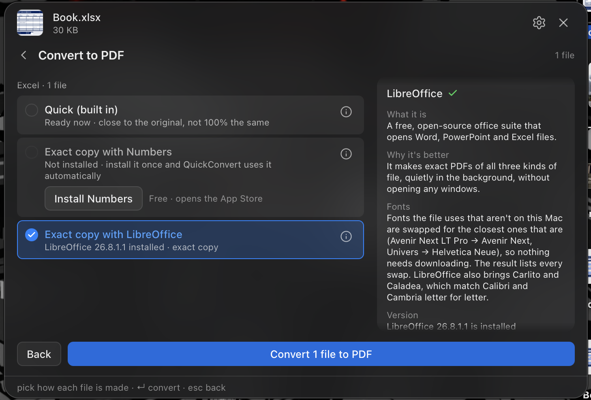

| | |
|---|---|
| 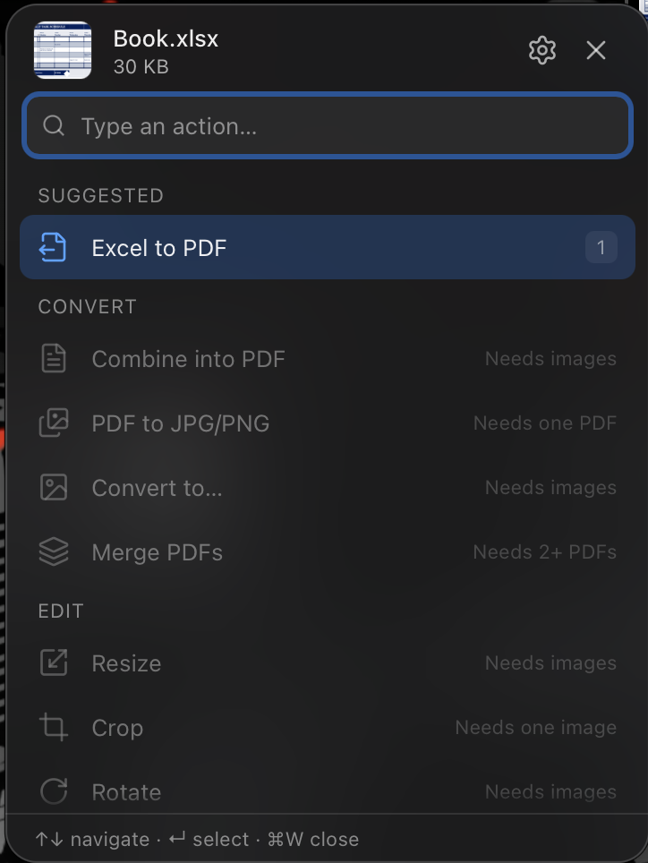 | 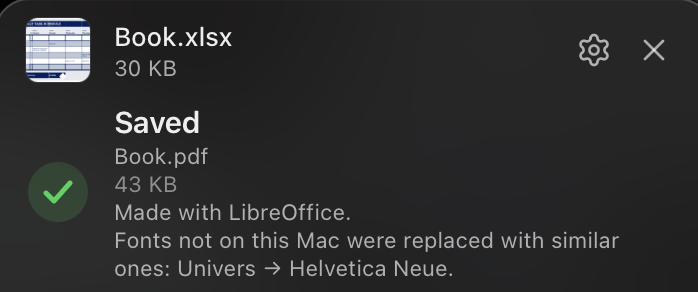 |
| 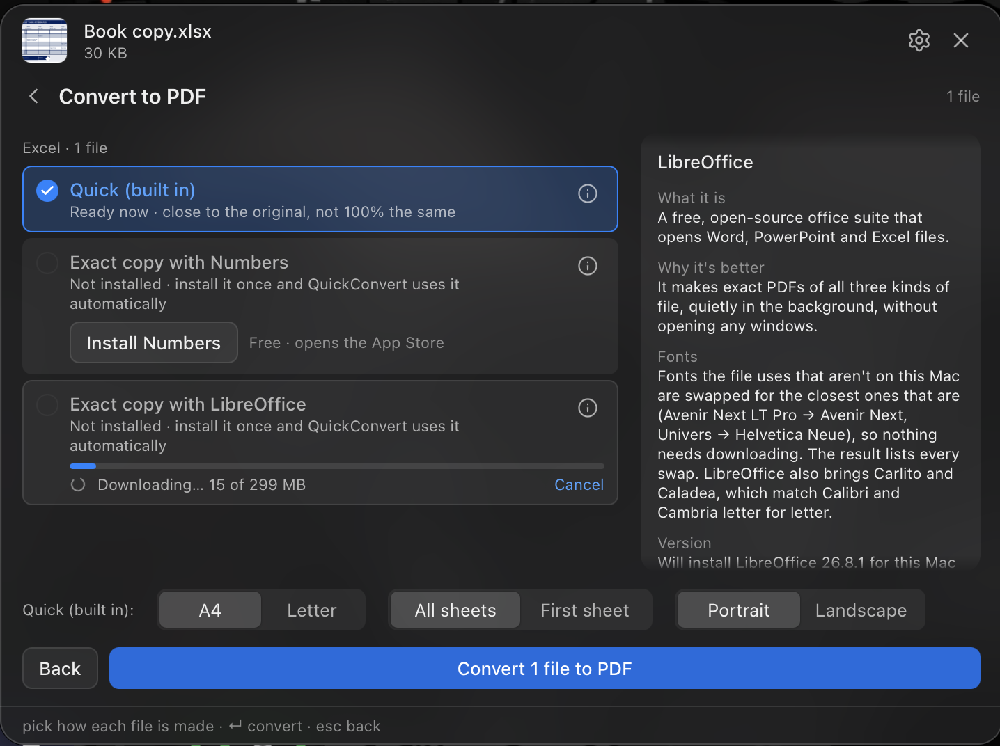 | 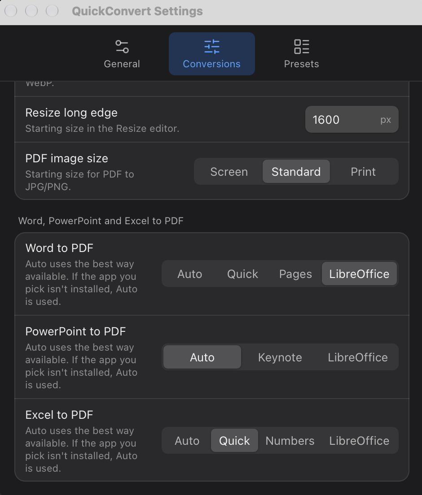 |

Every action writes a new file next to the original (or into a folder you choose) and never changes or overwrites the original.

| | |
|---|---|
| 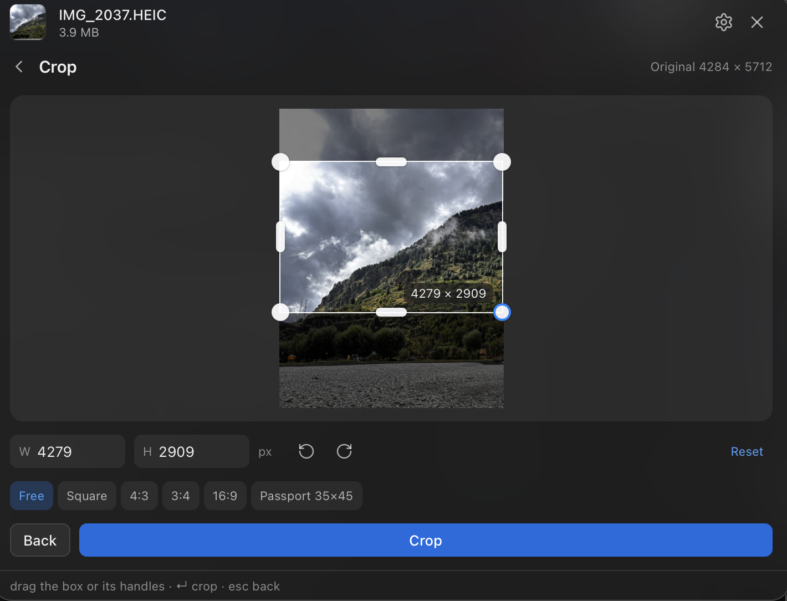 | 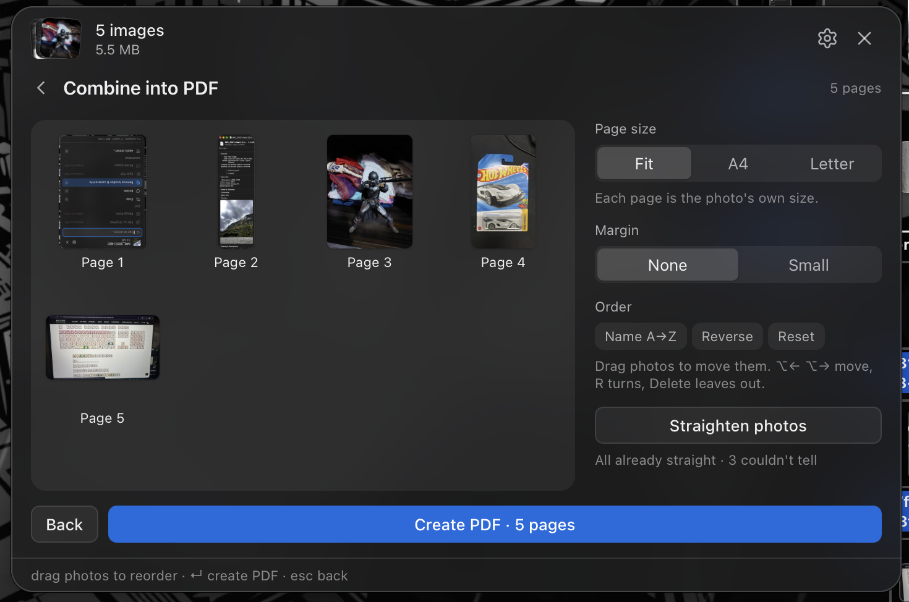 |
| 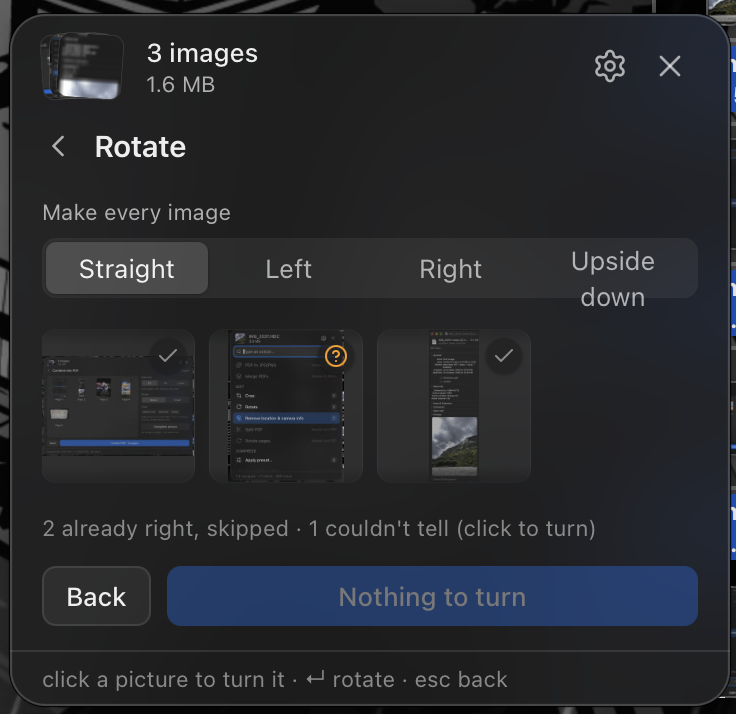 | 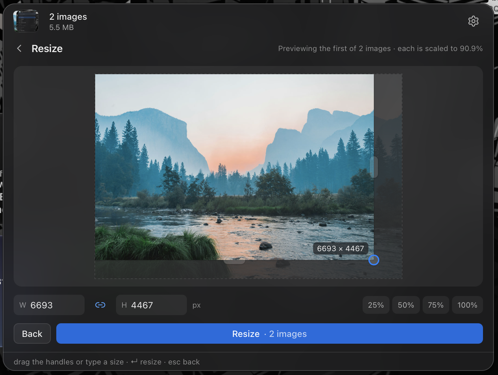 |
| 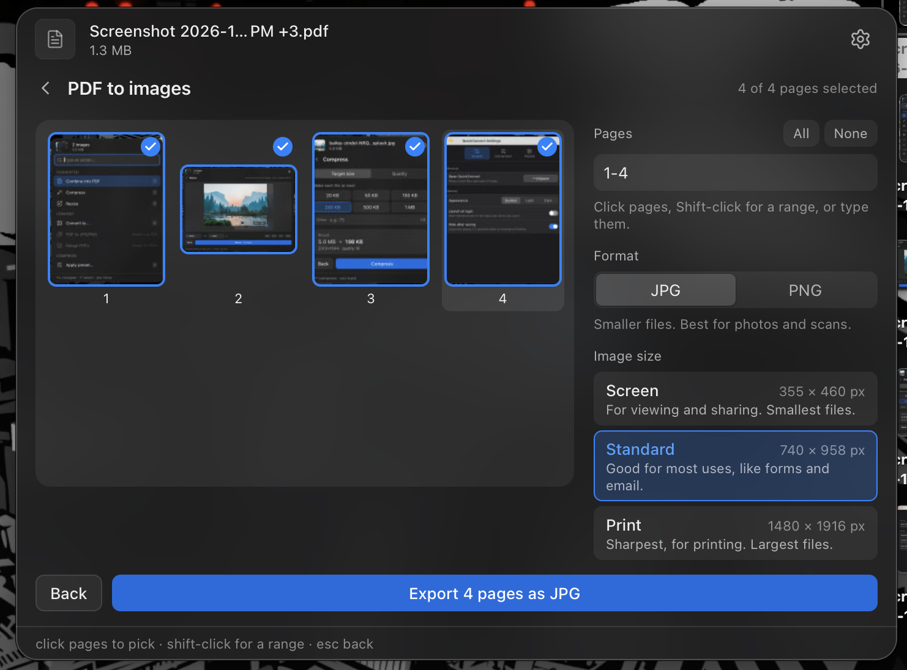 | 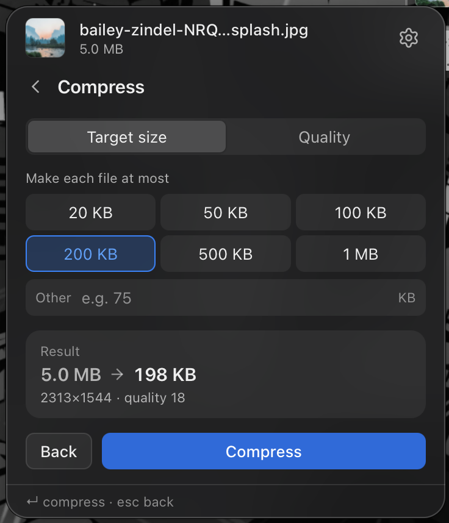 |

## Install (macOS 12 or later, Apple Silicon or Intel)

1. Download `QuickConvert_<version>_universal.dmg` from the [Releases](https://github.com/Ripun-Build/quickconvert/releases) page and drag **QuickConvert** to **Applications**.
   Already have an older version? See [Updating](#updating).
2. **First launch:** the app isn't notarised by Apple yet, so macOS will say it's from an unidentified developer. Right-click (or Control-click) **QuickConvert** in Applications and choose **Open**, then **Open** again. You only need to do this once.
   On recent macOS versions, if there's no Open button: try to open it once, then go to **System Settings → Privacy & Security** and click **Open Anyway**.
3. QuickConvert lives in the **menu bar** (no Dock icon). The first time you use it on a Finder selection, macOS asks whether QuickConvert may control Finder: choose **Allow** so it can see which files you've selected.

## Updating

QuickConvert doesn't check for updates by itself yet. To get a new version (for example from 0.2 to 0.3):

1. **Quit QuickConvert first:** menu bar icon → **Quit**. If the old version keeps running, both fight over the shortcut.
2. Download the new `.dmg` from [Releases](https://github.com/Ripun-Build/quickconvert/releases), drag **QuickConvert** to **Applications** and choose **Replace**.
3. **Right-click → Open → Open once more.** macOS treats each new version as a new app, so the "unidentified developer" warning comes back one time.
4. If macOS asks again whether QuickConvert may control Finder, choose **Allow**.

Your settings, presets and *Launch at login* carry over. To hear about new versions, click **Watch → Custom → Releases** on this page.

## Use

- **Select files in Finder, press ⌃⇧Space.** The popup appears at the pointer with the actions that make sense for those files, the best ones first under *Suggested*.
- Type to search, use **↑ ↓** and **Return**, or press **1–9**. **Esc** goes back one step.
- The popup stays open until you close it with its **×** or **⌘W**, so you can drag more files in or switch apps. Drag its top bar to move it.
- No selection? The popup opens as a drop zone: drag files in or click **Choose files…**.
- **Settings** (menu bar icon → Settings…, the ⚙ in the popup, or **⌘,**): change the shortcut, appearance (System / Light / Dark), where files are saved, default quality and sizes, presets, how Word, PowerPoint and Excel files are made into PDFs, and launch at login.

## Build from source

Requirements: [Rust](https://rustup.rs) (stable), Node.js LTS, and Xcode Command Line Tools (`xcode-select --install`).

```bash
npm install
sh scripts/fetch-pdfium.sh   # once: downloads the PDF engine (pinned version, checksum-verified)
npm run tauri dev            # run in development
```

Release build (universal: Apple Silicon + Intel):

```bash
rustup target add aarch64-apple-darwin x86_64-apple-darwin
npm run tauri build -- --target universal-apple-darwin
```

The `.dmg` ends up in `src-tauri/target/universal-apple-darwin/release/bundle/dmg/`.

Checks:

```bash
cd src-tauri && cargo test && cargo clippy --all-targets -- -D warnings
npm test && npx tsc --noEmit
```

Docs: [SPECS](docs/SPECS.md) (what it does) · [DESIGN](docs/DESIGN.md) (design system) · [TASKS](docs/TASKS.md) (milestones).

## Licences

QuickConvert is released under the [MIT License](LICENSE).

It bundles open-source components, all under permissive licences (MIT, Apache-2.0, BSD and similar; nothing GPL), including the [PDFium](https://pdfium.googlesource.com/pdfium/) engine built by [bblanchon/pdfium-binaries](https://github.com/bblanchon/pdfium-binaries). The full list, with every Rust crate and JavaScript package, is in [THIRD_PARTY_LICENSES.md](THIRD_PARTY_LICENSES.md); licence texts for PDFium and its parts are in [`src-tauri/resources/pdfium/licenses`](src-tauri/resources/pdfium/licenses) and ship inside the app.
